# Summary

Dengue is one of Sri Lanka's largest public-health burdens, and the number of cases changes sharply from
week to week. This project builds and evaluates a machine-learning model that predicts **the number of
dengue cases each Regional Director of Health Services (RDHS) division will notify in the following
week**, using only official surveillance figures from the Epidemiology Unit's *Weekly Epidemiological
Report*.

The model is **NGBoost** (Natural Gradient Boosting, Duan et al., 2020). This algorithm was not covered in
the lectures. It is a boosting method that predicts a whole probability distribution rather than a single
number, so every forecast comes with an uncertainty range. It was compared with two naive benchmarks,
ridge regression, a random forest and an NGBoost Poisson variant. All models were scored with a rolling,
time-ordered evaluation, and two final weeks were held out and never used for any decision.

Key results (hold-out test, 52 division-weeks):

* NGBoost reduced the error on the log scale from **0.371 (naive "same as last week") to 0.299**. The
  weighted absolute percentage error fell from **32.2 % to 16.2 %**. It was better than the naive
  forecast in **22 of 26 divisions**. However, the 95 % bootstrap interval for the improvement
  (−0.129 to +0.015) still includes zero, because the test set is very small.
* NGBoost, the random forest and NGBoost-Poisson performed almost identically (differences ≤ 0.004).
  The benefit comes from learning **growth dynamics from the data**, not from NGBoost in particular.
* The predicted uncertainty ranges were **too narrow**: nominal 90 % intervals contained only 67 % of
  test outcomes.
* SHAP, permutation importance and partial dependence agree with epidemiological intuition. The model
  learned that (i) when national incidence is falling, division counts also fall, (ii) sudden one-week
  jumps tend to partly reverse, and (iii) very small counts tend to drift upwards.

The main limitation is the data. The verified dataset contains **only ten weekly reports (weeks 24–33 of
2026)**. One of these is a known duplicate, and a data-quality audit in this project found another week
whose division counts are misaligned. The results are therefore a careful **proof of concept**, not an
operational early-warning system. A Streamlit web application lets users explore forecasts, enter their
own figures and see SHAP explanations.

# 1. Problem definition and dataset

## 1.1 Problem and relevance

Sri Lanka reports tens of thousands of dengue cases every year. The dataset used here records 82,956
cases in 2023, 52,214 in 2024 and 50,501 in 2025, and 90,905 in 2026 up to week 33. Cases follow a
recurring yearly pattern with a mid-year peak around June–July and a second peak around
December–January (Chandrasiri, 2017). Medical Officers of Health (MOH) and RDHS offices must decide each
week where to send vector-control teams and how to prepare hospital capacity. A reliable **one-week-ahead
forecast per division** is directly useful for that planning.

*Machine-learning task:* supervised regression on a panel of time series. For division *d* at week
*t*, predict $y_{d,t+1}$, the cases notified in the following week.

## 1.2 Data source

| Item | Detail |
|---|---|
| Primary source | Epidemiology Unit, Ministry of Health, Sri Lanka — *Weekly Epidemiological Report*, Table 1 (cases notified by MOHs, by RDHS division) |
| Compiled by | research.dulajmendis.com, dataset *disease-surveillance*, version 2026-10-10 (first and only release) |
| How obtained | Downloaded as an Excel workbook. Its SHA-256 hash was checked automatically against the hash published on the compiler's page, and the two match |
| Coverage | Weekly counts for **weeks 24–33 of 2026** (week ending 14 Jun – 16 Aug 2026) for **26 RDHS divisions** plus the national total; year-to-date counts for the same weeks; annual totals for 2023, 2024 and 2025 |
| Size | 1,242 rows (621 dengue, 621 leptospirosis; leptospirosis not used) |
| Ethics | Aggregated counts only. No personal, identifiable or sensitive individual data. The Epidemiology Unit asks to be acknowledged as the primary source, and it is acknowledged here |

The project uses only the values in this file. **No records were created, interpolated or imputed from
outside sources.** Weather, mosquito-index and population data would be useful, but they are not part of
the verified dataset, so they are not used. They are discussed as future work.

## 1.3 Data-quality audit

An automated audit (`src/dengue/data_quality.py`) checks the raw file before any modelling:

| Check | Result |
|---|---|
| File hash equals published hash | Passed |
| 26 division counts sum to the national total, every week | Passed (difference 0) |
| Year-to-date(t) − year-to-date(t−1) = weekly count(t), weeks 25–33 | Passed (difference 0) |
| No missing or negative values | Passed |
| No week identical to the previous week | **Failed — week 26 (28 Jun) repeats week 25 exactly** |

**Week 26 duplicate.** The compiler's notes confirm that report Vol. 53 No. 27 re-printed the week-25
dengue counts for all 26 divisions. The true week-26 counts are therefore unknown. **Decision:** treat
week 26 as missing; do not guess it.

**Week 24 misalignment (found by this project).** Figure 3 shows the Spearman rank correlation between
each week's 26 division counts and (a) the following week and (b) the 2023–25 average annual burden.
Every week from 25 to 33 correlates at **0.95–1.00** with the next week and **0.76–0.83** with historical
burden. Week 24 correlates at **0.08** and **0.03**. Colombo, normally the largest division, shows 20
cases in week 24 and 1,138 the next week. Kilinochchi shows 419 cases, more than its entire 2025 total of
127. The week-24 values still add up to the correct national total (3,973), so the numbers were probably
attached to the wrong divisions somewhere in transcription. The original PDF could not be checked from
the project environment. **Decision:** keep the national week-24 total, set the division-level week-24
counts to missing, and record the issue in `data/raw/DATA_SOURCE.md`.

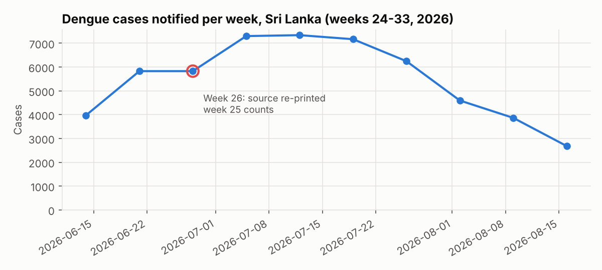{width=85%}

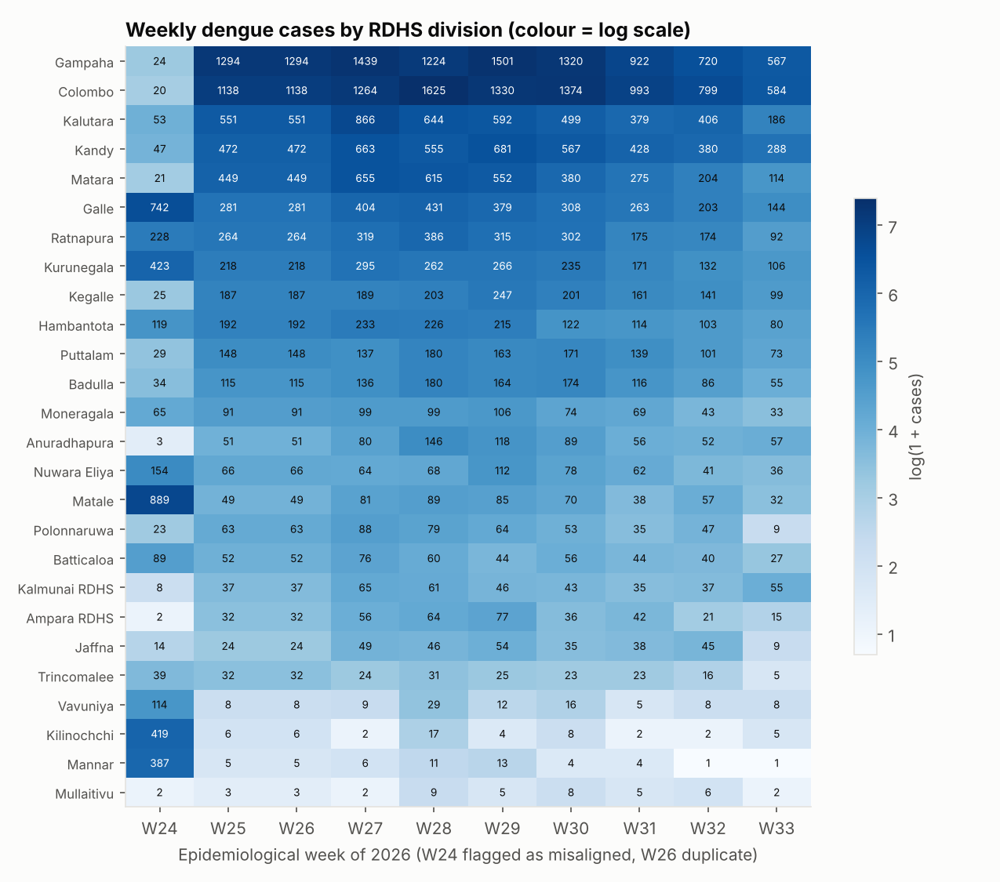{width=80%}

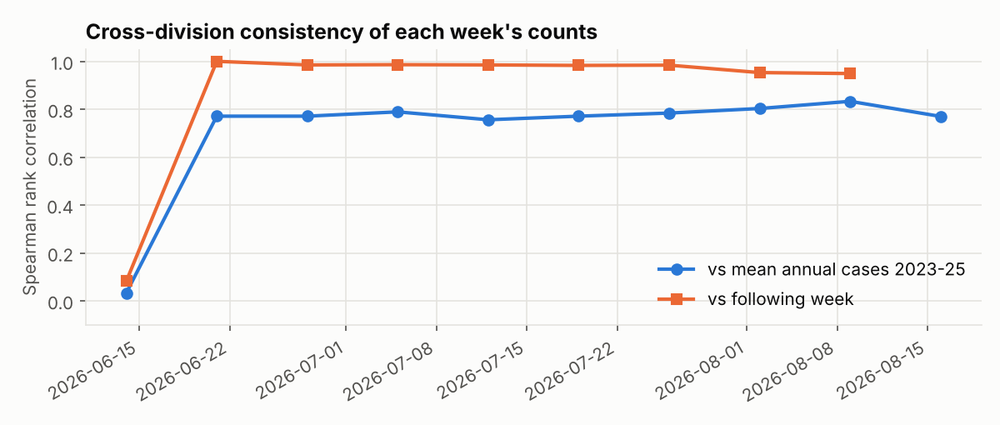{width=85%}

## 1.4 Features and target

After cleaning, each row is one division-week. All features are calculated **only from information
available at the end of week t**, so no future data leaks into the inputs (this is checked by a unit
test).

| Feature | Definition | Rationale |
|---|---|---|
| `log_cases_t` | log(1 + cases in week t) | Current level |
| `log_cases_t1` | log(1 + cases in week t−1) | Recent history |
| `growth_t` | log_cases_t − log_cases_t1 | Local momentum |
| `log_hist_annual` | log(1 + mean annual cases 2023–25) | Typical burden of the division |
| `season_ratio_t` | log_cases_t − log(1 + historical mean weekly cases) | How unusual this week is for the division |
| `log_national_t` | log(1 + national cases in week t) | Phase of the national epidemic |
| `national_growth_t` | national log growth from t−1 to t | National momentum |

**Target.** The learned models predict the **log growth**
$r = \log(1+y_{t+1}) - \log(1+y_t)$, and convert it back with $\hat y_{t+1} = \exp(\log(1+y_t)+\hat r)-1$.
Weekly counts range from 1 (Mannar) to 1,625 (Colombo). Predicting growth instead of raw counts lets one
model learn from small and large divisions together. The NGBoost-Poisson variant predicts the raw counts
directly, which tests this design choice.

**Preprocessing.** The log transforms stabilise variance. Missing lag values (for rows whose previous
week was excluded) are filled with the training-set median inside each fold, so information from the
test set never enters the imputation. Ridge regression also uses standardisation. No category encoding
is needed: division identity enters only through the historical-burden feature, so the model can be
applied to any division.

**Resulting dataset:** 156 supervised rows = 26 divisions × 6 target weeks (weeks 28–33). Only six target
weeks exist because a valid target needs a valid current week, so the missing weeks 24 and 26 cannot be
used as inputs or targets.

# 2. Algorithm: NGBoost (Natural Gradient Boosting)

## 2.1 What it is

NGBoost (Duan et al., ICML 2020) is a **boosting algorithm for probabilistic prediction**. It assumes the
target follows a parametric distribution $P_\theta(y\mid x)$, here a Normal distribution with parameters
$\theta=(\mu, \log\sigma)$. It learns **every parameter as a function of x** by gradient boosting:

1. Start from a constant fit of θ (the marginal distribution).
2. At each boosting stage, compute the gradient of a proper scoring rule (the log-likelihood) with
   respect to θ for every training row.
3. Pre-multiply that gradient by the inverse **Fisher information matrix**. This gives the **natural
   gradient**, which measures steps by how much the *distribution* changes, not how much the raw
   parameters change. Learning is therefore stable and does not depend on how the distribution is
   parameterised.
4. Fit one shallow regression tree per parameter to the natural gradients, and add them with a
   line-searched step size and a learning rate.

The output is a full predictive distribution for each division-week. From it the project reports a point
forecast (the median) and 80 % and 90 % prediction intervals.

## 2.2 Why NGBoost was selected

* **Uncertainty is essential for public-health planning.** A forecast of "430 ± 20" calls for different
  action from "430 ± 200". NGBoost gives a separate uncertainty for every row (heteroscedastic), with no
  extra modelling.
* **Small, tabular, non-linear data.** Shallow-tree boosting captures thresholds and interactions (for
  example, "growth reverses only when the division is large") that linear models miss, and it does not
  need large data like deep learning does. Deep learning is excluded by the assignment.
* **Explainable.** Its base learners are trees, so exact TreeSHAP explanations can be computed for the
  predicted mean.
* **Not part of the lecture syllabus** (decision trees, linear and logistic regression, k-NN and similar
  standard models were covered).

## 2.3 How it differs from standard models

| | Linear / ridge regression | Decision tree / random forest | Gradient boosting (e.g. XGBoost) | **NGBoost** |
|---|---|---|---|---|
| Output | One number | One number (average of leaves) | One number | **Full distribution (μ and σ per row)** |
| Non-linearity | No | Yes | Yes | Yes |
| Training signal | Least squares | Variance reduction | Ordinary gradient of a loss | **Natural gradient of a scoring rule, for all parameters** |
| Uncertainty | Constant residual variance at best | Not built in | Not built in (only quantile tricks) | **Built in, varies per row** |

A Poisson NGBoost was also tested (predicting counts directly). Choosing between the two NGBoost variants
was a modelling decision, so it was made on the **validation** folds only.

# 3. Training and evaluation

## 3.1 Time-respecting splits

Random K-fold splitting would leak future information, so a **rolling-origin (expanding-window)**
design was used. Each prediction for target week *w* comes from a model trained only on target weeks
before *w*.

| Role | Target weeks (week ending) | Rows |
|---|---|---|
| Training only (first fold) | W28 (12 Jul) | 26 |
| **Validation** (hyperparameter tuning, model choice) | W29, W30, W31 (19 Jul, 26 Jul, 2 Aug) | 78 |
| **Test** (hold-out, used once at the end) | W32, W33 (9 Aug, 16 Aug) | 52 |
| Genuine forecast (no actual value available) | W34 (23 Aug) | 26 |

Hyperparameters were chosen by grid search, minimising the combined validation error on the log scale.
For each test week the model is retrained on **all** earlier weeks with the chosen settings, as it
would be in real use.

## 3.2 Hyperparameters

| Model | Search grid | Selected |
|---|---|---|
| Ridge regression | α ∈ {0.1, 1, 10, 100} | α = 100 |
| Random forest (500 trees) | max_depth ∈ {2, 3, None} × min_samples_leaf ∈ {3, 5, 10} | None, 3 |
| NGBoost Normal | n_estimators ∈ {100, 300} × learning_rate ∈ {0.01, 0.03, 0.1} × tree depth ∈ {2, 3} | 100, 0.03, depth 2 |
| NGBoost Poisson | same grid | 100, 0.1, depth 3 |

The tuning favoured **small, strongly regularised models** (few boosting rounds, depth 2, heavy ridge
penalty), which is what one would expect with 26–104 training rows per fold. With α ≤ 10, ridge
validation error grew to more than 1.0 on the log scale, which shows how easily linear models over-fit
here.

## 3.3 Metrics

* **MAE_log**: mean absolute error of log(1 + cases). This is the main metric because it treats a 50 %
  miss in Mannar and in Colombo equally.
* **MAE, RMSE** (cases) and **WAPE** = Σ|error| / Σ actual, which are dominated by the large divisions.
* **R²_log**, and **bias** (mean of prediction − actual).
* For the probabilistic models: **interval coverage** (share of actual values inside the 80 % or 90 %
  interval) and mean interval width.

## 3.4 Results

**Table 1 – Test set (W32–W33, n = 52)**

| Model | MAE | RMSE | WAPE % | MAE_log | R²_log | Bias |
|---|---|---|---|---|---|---|
| Naive persistence (ŷ = y_t) | 40.5 | 69.4 | 32.2 | 0.371 | 0.890 | +36.8 |
| Naive drift (continue last growth) | 27.3 | 49.0 | 21.7 | 0.430 | 0.836 | +4.1 |
| Ridge regression | 35.6 | 63.9 | 28.3 | 0.404 | 0.890 | −17.8 |
| Random forest | **19.7** | **32.3** | **15.6** | 0.297 | 0.919 | +8.6 |
| NGBoost (Poisson, counts) | 21.0 | 37.5 | 16.7 | **0.296** | **0.926** | +6.8 |
| **NGBoost (Normal, log-growth)** — proposed | 20.4 | 33.1 | 16.2 | 0.299 | 0.919 | +10.0 |

**Table 2 – Validation folds (W29–W31, n = 78)**

| Model | MAE | WAPE % | MAE_log |
|---|---|---|---|
| Naive persistence | 51.1 | 22.1 | 0.2860 |
| Naive drift | 72.4 | 31.4 | 0.4557 |
| Ridge regression | 99.8 | 43.2 | 0.4699 |
| Random forest | 41.6 | 18.0 | 0.3070 |
| NGBoost (Poisson) | 43.4 | 18.8 | 0.3055 |
| NGBoost (Normal) | 42.8 | 18.6 | 0.2863 |

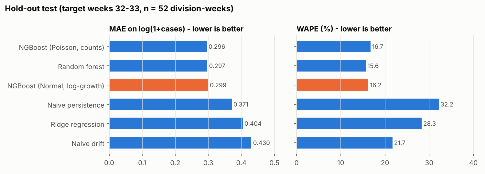{width=95%}

**Table 3 – Paired bootstrap on the test set** (5,000 resamples of divisions; difference in MAE_log,
NGBoost minus the other model; negative values favour NGBoost)

| Compared with | Mean difference | 95 % CI | Divisions where NGBoost is better |
|---|---|---|---|
| Naive persistence | −0.071 | [−0.129, +0.015] | 22 / 26 |
| Naive drift | −0.131 | [−0.221, −0.048] | 16 / 26 |
| Ridge regression | −0.105 | [−0.168, −0.031] | 21 / 26 |
| Random forest | +0.002 | [−0.038, +0.052] | 10 / 26 |
| NGBoost (Poisson) | +0.004 | [−0.033, +0.044] | 13 / 26 |

**Table 4 – Prediction intervals of NGBoost (Normal)**

| Split | 80 % PI coverage | 80 % mean width | 90 % PI coverage | 90 % mean width |
|---|---|---|---|---|
| Validation | 43.6 % | 80.5 cases | 56.4 % | 103.7 cases |
| Test | 55.8 % | 56.7 cases | 67.3 % | 73.2 cases |

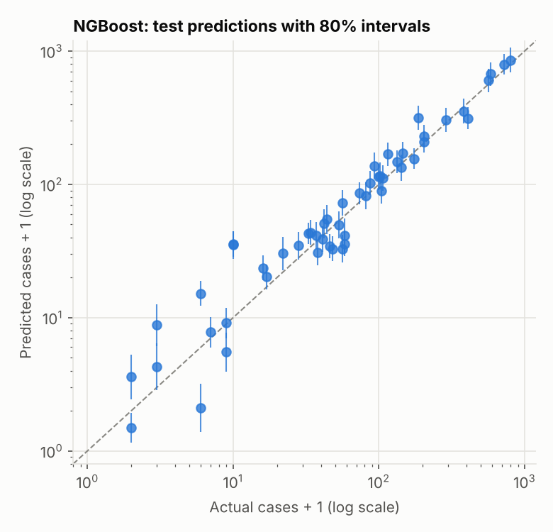{width=55%}

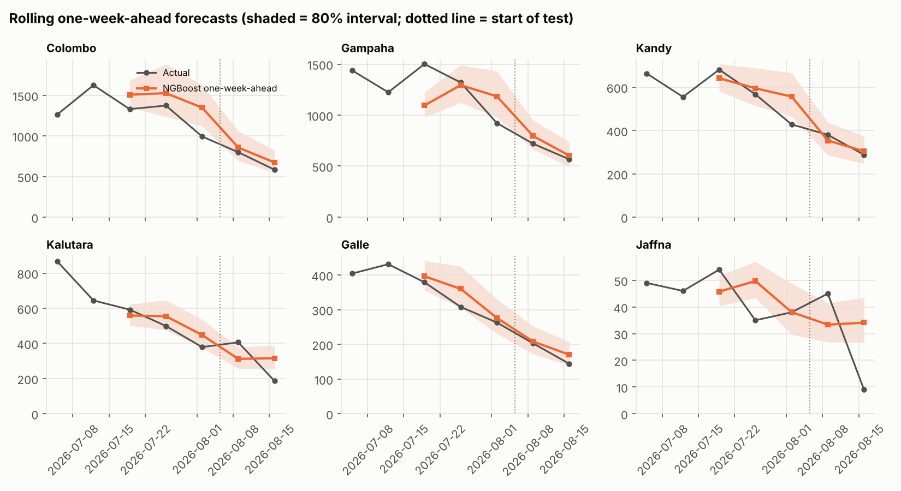{width=100%}

## 3.5 What the results show

1. **Learning helps compared with "same as last week".** During the test weeks the epidemic was declining
   (national 4,594 → 3,865 → 2,682), and persistence over-predicted by 37 cases per division on average.
   The tree-based models learned that falling national incidence predicts further falls. They cut WAPE
   roughly in half and beat persistence in 22 of 26 divisions. The improvement in MAE_log is not
   statistically conclusive (its CI touches zero), so it is reported as **promising, not proven**.
2. **On the validation weeks, NGBoost only tied persistence** (0.2863 vs 0.2860 MAE_log). Those weeks
   include the peak and the turn of the epidemic. No model trained on one to three earlier weeks could
   anticipate the turning point. This is an honest limitation of a ten-week dataset.
3. **NGBoost vs random forest vs NGBoost-Poisson: no meaningful difference.** The bootstrap intervals
   comfortably include zero. NGBoost's added value is its **predictive distribution**, not a lower point
   error. NGBoost-Normal was kept because it had the lowest validation error, chosen before the test set
   was looked at.
4. **Ridge regression and naive drift performed poorly.** Linear extrapolation of growth turns one noisy
   week into large errors.
5. **The intervals are too narrow.** The 90 % intervals covered only 56–67 % of outcomes. With 26–130
   training rows, NGBoost underestimates σ, and it cannot know about one-off reporting artefacts. The
   intervals should be read as *relative* uncertainty (wider = less certain) rather than calibrated
   probabilities. Recalibration (for example conformal prediction) needs more weeks of data.

## 3.6 Sensitivity and ablation analyses

**Week-26 policy.** Re-running the whole experiment with week 26 kept *as printed* changes the ranking.
NGBoost-Normal's test MAE_log rises to 0.317, the random forest scores 0.290 and ridge 0.303. NGBoost-
Poisson degrades to 0.420. The duplicated week adds 26 rows of fake zero growth, which bias the models
towards "no change". This shows how strongly the conclusions depend on how a single faulty report is
handled (`reports/tables/model_metrics_sensitivity_week26_as_printed.csv`).

**Feature ablation** (NGBoost, same hyperparameters, test set):

| Feature set | MAE_log | WAPE % |
|---|---|---|
| All 7 features | **0.299** | **16.2** |
| Without the two national features | 0.334 | 21.4 |
| Division lags only (3 features) | 0.306 | 18.9 |

The national context helps: removing it increases WAPE by about five points.

# 4. Explainability and interpretation

All explanations refer to NGBoost's **predicted log growth** (μ). Negative values mean cases are
expected to fall. Three complementary methods were used.

## 4.1 SHAP (TreeSHAP, exact for tree ensembles)

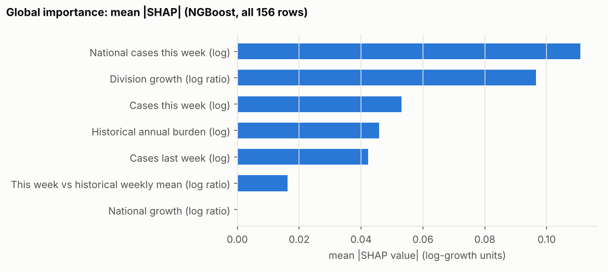{width=85%}

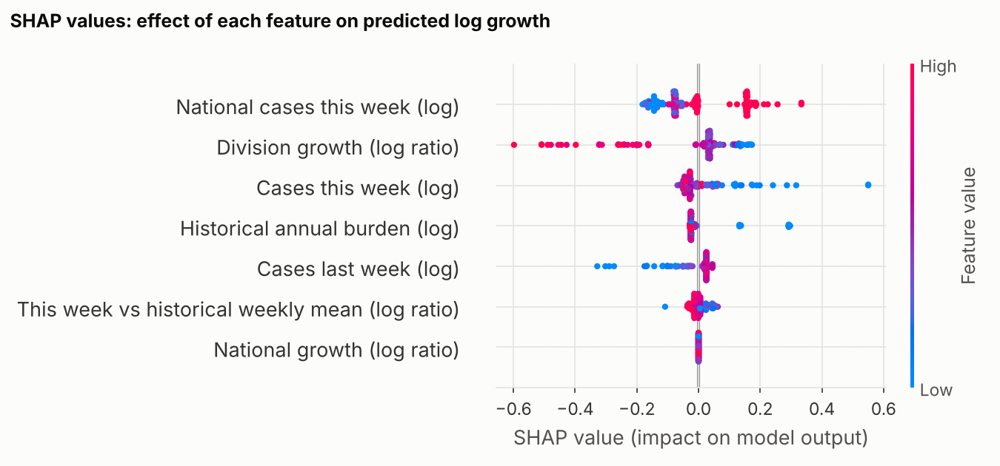{width=90%}

| Rank | Feature | mean \|SHAP\| NGBoost | mean \|SHAP\| random forest |
|---|---|---|---|
| 1 | National cases this week | 0.111 | 0.107 |
| 2 | Division growth | 0.097 | 0.110 |
| 3 | Cases this week | 0.053 | 0.064 |
| 4 | Historical annual burden | 0.046 | 0.045 |
| 5 | Cases last week | 0.042 | 0.038 |
| 6 | This week vs historical weekly mean | 0.016 | 0.027 |
| 7 | National growth | 0.000 | 0.007 |

The random forest, an independently trained model, ranks the features almost identically. This
suggests the explanations reflect patterns in the data rather than quirks of one algorithm.

## 4.2 Permutation importance (hold-out test)

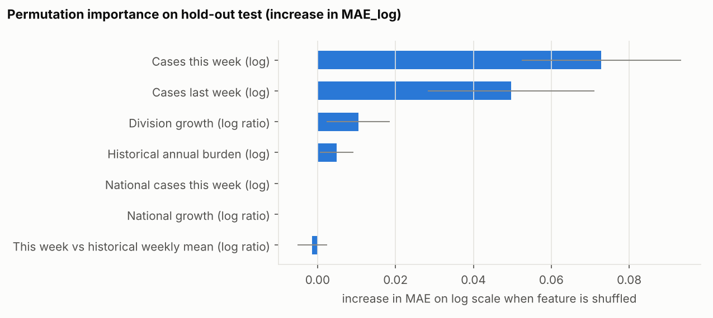{width=85%}

On the test set, the division's own recent counts matter most (+0.073 and +0.050 MAE_log when shuffled).
The national features show **zero** permutation importance. This is not a contradiction of SHAP; it is
a warning. The model used for this test was trained on weeks when national counts were 6,246–7,340. Both
test weeks (4,594 and 3,865) fall **below** that range, so a tree places them in the same leaf, and
shuffling them changes nothing. Tree models **cannot extrapolate** beyond the values they were trained on.
The same issue affects the genuine W34 forecast: the latest national count (2,682) is lower than any
training week. The web app shows a warning about this.

## 4.3 Partial dependence and ICE

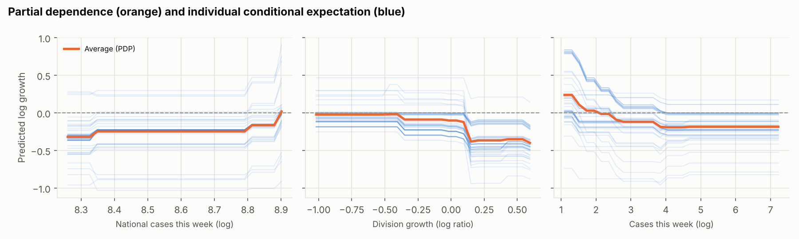{width=100%}

* **National cases:** at the lowest national levels (about 3,900) the predicted growth is −0.32 (about
  −27 % per week). Near the peak (about 7,300) it is about 0. The model has learned the **phase of the
  national epidemic**.
* **Division growth:** after a rise of more than about 15 % in one week, predicted next-week growth
  drops to around −0.37 to −0.40. After a fall, it stays near −0.02. Sudden jumps tend to **partly
  reverse** (regression to the mean). In surveillance data this is often caused by reporting batches and
  delays.
* **Cases this week:** divisions with very few cases (about 2) are predicted to rise (+0.24). Divisions
  above about 70 cases are predicted to fall by about −0.18. Small counts are noisy and tend to drift back
  up towards typical levels.

## 4.4 Local explanation of one forecast

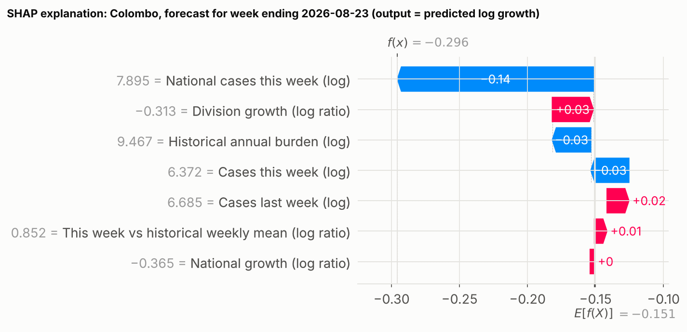{width=90%}

For Colombo (584 cases in W33), NGBoost forecasts **434 cases** for W34 (80 % interval 334–565).
The national level is the largest contributor to the predicted decline (−0.14 of the −0.30 total log
growth).

## 4.5 Does the model agree with domain knowledge?

* **Yes:** dengue epidemics rise and fall over several weeks, driven by mosquito breeding during the
  monsoon. Using the national epidemic phase as the strongest signal makes sense, because all divisions
  in the southwest share the same monsoon. Large divisions (Colombo, Gampaha) moving together is well
  known. Regression to the mean after reporting spikes is a recognised feature of notification data.
* **With caution:** the model has only ever seen one season, and only the peak and decline. It cannot
  know that a second peak usually follows around December–January (Chandrasiri, 2017). Its message
  "falling national cases → keep falling" would eventually be wrong when the next season begins.
* National growth adds almost nothing, because it is nearly identical to the national level within this
  short window.

# 5. Critical discussion

**Model limitations.**
(1) Six usable target weeks from one season. The model cannot learn seasonality, cannot see a turning
point in advance, and cannot extrapolate beyond the range of national values it has seen.
(2) The 52-row test set gives wide confidence intervals; the differences between models are within
noise.
(3) Prediction intervals are under-calibrated (67 % coverage at a nominal 90 %).
(4) The forecast horizon is only one week. Planning vector control may need 2–4 weeks of lead time.

**Data-quality issues.**
(1) Week 26 is a re-print of week 25 (confirmed by the compiler). (2) Week-24 division counts appear
misaligned (found here; not confirmed against the original PDF). (3) Because of the week-26 re-print,
year-to-date figures from week 26 onward are inflated by the week-25 counts, so year-to-date was **not
used as a feature**. (4) The dataset was compiled partly with automated tools, and its page advises
checking figures against the source. (5) Report weeks changed from Saturday–Friday (up to 2025) to
Monday–Sunday (2026), so annual totals are not perfectly comparable.

**Bias and fairness risks.**
*Notified* cases are not the same as *infections*. Divisions with better laboratory access, more
hospital capacity or more health-seeking behaviour (typically urban Western Province) report more. A
model trained on notifications can therefore reproduce under-reporting in rural, Northern and Eastern
divisions: low reported counts lead to low forecasts, and potentially to fewer resources. Relative errors
are also largest for the smallest divisions (Mannar, Mullaitivu, Kilinochchi), so these areas get the
least reliable forecasts. Any operational use should combine the forecast with local MOH knowledge and
should never reduce resources for a division based on the model alone.

**Real-world impact and ethics.**
With more data, a probabilistic weekly forecast could help RDHS offices plan fogging, breeding-site
inspections and hospital beds a week ahead. The risks are false reassurance (an under-predicted surge)
and wasted resources (an over-predicted one). This is why the app always shows intervals, labels itself
as a research prototype and states that its intervals were too narrow in testing. The data are
aggregated and public, and the Epidemiology Unit is credited as requested. No personal data were used.

**Future work.**
Extend the series back several years from the archived Weekly Epidemiological Reports, which would
allow seasonality and two-peak learning. Add rainfall and temperature data from the Department of
Meteorology, and division populations to compute incidence rates. Use conformal recalibration of the
intervals. Forecast 2–4 weeks ahead. Verify week 24 against the original report.

# 6. Front-end (bonus)

A **Streamlit** application (`app/streamlit_app.py`) has five tabs:

1. **Next-week forecast:** national and per-division forecasts for the week ending 23 Aug 2026 with
   80 % and 90 % intervals, a comparison chart and a CSV download.
2. **Division explorer:** observed series (excluded weeks marked), rolling validation and test
   predictions with intervals, the next-week forecast, and a SHAP waterfall with a plain-language list of
   the top drivers.
3. **What-if prediction:** the user enters this week's and last week's division and national counts and
   gets a prediction, intervals and a SHAP explanation. A warning appears when the inputs fall outside
   the training range.
4. **Model performance:** all metric tables, the bootstrap comparison and the result figures.
5. **Data & limitations:** provenance, the automated quality checks and the known limitations.

# 7. Reproducibility

```
python -m venv .venv && .venv\Scripts\activate      (Windows)
pip install -r requirements.txt && pip install -e .
python scripts/run_pipeline.py      # about 5 min: audit, tuning, test, XAI, figures, model
python -m pytest -q                 # 10 tests (data integrity, no leakage, models)
streamlit run app/streamlit_app.py
```

All randomness is seeded (`random_state = 42`). Every number in this report is produced by the pipeline
and stored in `reports/tables/`.

# References

* Chandrasiri, K. A. D. S. (2017). *Dengue – identifying the disease pattern in Sri Lanka.* Peradeniya
  International Economics Research Symposium (PIERS) 2017, University of Peradeniya, pp. 55–62.
  <https://ir.lib.pdn.ac.lk/handle/20.500.14444/4250>
* Duan, T., Avati, A., Ding, D. Y., Thai, K. K., Basu, S., Ng, A. Y., & Schuler, A. (2020). NGBoost:
  Natural Gradient Boosting for Probabilistic Prediction. *Proceedings of the 37th International
  Conference on Machine Learning (ICML)*. <https://arxiv.org/abs/1910.03225>
* Epidemiology Unit, Ministry of Health, Sri Lanka. *Weekly Epidemiological Report*, Table 1.
  Compiled by research.dulajmendis.com, dataset *disease-surveillance*, version 2026-10-10.
  <https://research.dulajmendis.com/data/disease-surveillance/>
* Lundberg, S. M., & Lee, S.-I. (2017). A Unified Approach to Interpreting Model Predictions. *Advances
  in Neural Information Processing Systems 30*.
* Lundberg, S. M., et al. (2020). From local explanations to global understanding with explainable AI
  for trees. *Nature Machine Intelligence*, 2, 56–67.
